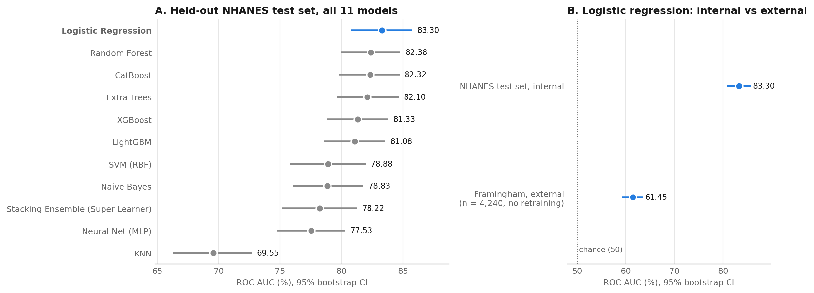

# Cardiovascular risk models on CDC NHANES, with external validation on Framingham

[](https://github.com/Yasir-Alazmi/cardiovascular-risk-external-validation/actions)
[](LICENSE)

This project compares 11 models (10 classifiers and a stacking ensemble) for predicting cardiovascular disease from routine clinical measurements, then tests the best one on a different cohort without retraining.



*Drawn by [`scripts/plot_summary.py`](scripts/plot_summary.py) from the committed CSVs only.*

**Key findings**
- Plain logistic regression has the best ROC-AUC (83.30 [80.80–85.77]); it is not significantly better than the runner-up, Random Forest (paired bootstrap p = 0.142).
- Transported unchanged to Framingham (n = 4,240), its ROC-AUC falls to 61.45 and specificity to 22.30: the model does not transfer across cohort designs.
- One global threshold gives 63.2% sensitivity for women vs 87.8% for men; subgroup calibration would be needed before any use.

## What is checked

The models are checked beyond a single accuracy number:

- 1,000-resample bootstrap confidence intervals, and a paired bootstrap test between the top two models;
- 5-fold stratified cross-validation with a Friedman test;
- robustness to simulated measurement noise;
- SHAP feature attributions;
- conformal prediction sets;
- a sex and age fairness check;
- external validation on a different cohort (Framingham) with no retraining.

**Data.** The main data is CDC NHANES 2015–2018: n = 11,288 adults, with 11.75% CVD prevalence. It is split 80/20, and the test set (n = 2,258) is used only for final evaluation. The decision threshold is fixed on the training data (Youden J) before the test set is touched. The Framingham Heart Study (n = 4,240) is used only for external validation.

Every number below is read from a committed file under [`results/nhanes_cardiovascular/`](results/nhanes_cardiovascular/). They were last reproduced on 2026-11-25 with `python scripts/reproduce_benchmarks.py` (seed 42). The tree-model figures can shift slightly between library builds and machines, even with the same seed; a re-run changed the runner-up model from CatBoost to Random Forest. Logistic regression stayed first.

> Research project. Not validated for clinical use.

## Results

### Held-out test set (n = 2,258)

| Model | ROC-AUC [95% CI] | Sensitivity [95% CI] | Specificity [95% CI] | PR-AUC | Brier | ECE |
|---|---|---|---|---|---|---|
| Logistic Regression | 83.30 [80.80 - 85.77] | 76.95 [71.43 - 82.01] | 75.48 [73.53 - 77.38] | 40.16 | 0.1595 | 0.2074 |
| Random Forest | 82.38 [79.93 - 84.79] | 73.89 [68.27 - 79.31] | 75.40 [73.52 - 77.21] | 35.78 | 0.1063 | 0.0995 |
| CatBoost | 82.32 [79.80 - 84.73] | 75.90 [70.37 - 81.39] | 74.96 [73.13 - 76.85] | 35.56 | 0.0978 | 0.0583 |
| Extra Trees | 82.10 [79.61 - 84.67] | 81.16 [76.34 - 85.77] | 69.51 [67.55 - 71.59] | 37.63 | 0.1232 | 0.1687 |
| XGBoost | 81.33 [78.83 - 83.80] | 80.77 [75.87 - 85.57] | 69.33 [67.29 - 71.43] | 32.93 | 0.1472 | 0.1604 |
| LightGBM | 81.08 [78.53 - 83.56] | 76.20 [70.64 - 81.36] | 72.18 [70.22 - 74.10] | 34.53 | 0.0976 | 0.0512 |
| SVM (RBF) | 78.88 [75.79 - 81.95] | 71.31 [65.42 - 77.23] | 75.28 [73.35 - 77.13] | 35.50 | 0.1672 | 0.2172 |
| Naive Bayes | 78.83 [76.02 - 81.78] | 66.00 [59.76 - 71.49] | 76.63 [74.75 - 78.49] | 32.38 | 0.1919 | 0.1927 |
| Stacking Ensemble (Super Learner) | 78.22 [75.16 - 81.26] | 72.69 [67.36 - 77.78] | 74.23 [72.28 - 76.24] | 33.91 | 0.1049 | 0.0597 |
| Neural Net (MLP) | 77.53 [74.75 - 80.31] | 67.84 [62.50 - 73.37] | 72.94 [70.99 - 74.87] | 31.64 | 0.1448 | 0.1427 |
| KNN | 69.55 [66.30 - 72.71] | 61.29 [55.51 - 67.04] | 70.88 [68.87 - 72.75] | 22.12 | 0.1908 | 0.2099 |

- **Plain logistic regression has the best discrimination.** A paired bootstrap test against the next model (Random Forest) gives an AUC difference of 0.92 points [-0.29%, 2.11%], with p = 0.142. So the two models are not significantly different. The stacking ensemble ranks near the bottom.
- **Discrimination and calibration disagree.** Logistic regression has the best AUC but poor calibration (ECE 0.21). LightGBM and CatBoost are much better calibrated (ECE 0.05–0.06). Which model is best depends on whether you need a ranking or a calibrated risk.

### 5-fold stratified cross-validation (n = 11,288)

| Model | ROC-AUC (mean ± sd) | Sensitivity | Specificity | PR-AUC | MCC | Brier |
|---|---|---|---|---|---|---|
| Logistic Regression | 83.65% ± 1.17% | 75.19% ± 1.95% | 76.15% ± 1.03% | 39.46% ± 2.61% | 0.361 | 0.1604 |
| Random Forest | 82.74% ± 0.87% | 45.02% ± 2.41% | 90.05% ± 0.68% | 36.46% ± 1.74% | 0.325 | 0.1055 |
| CatBoost | 82.72% ± 1.29% | 37.71% ± 1.66% | 92.49% ± 0.93% | 36.67% ± 2.38% | 0.311 | 0.0967 |
| Extra Trees | 82.51% ± 0.82% | 53.62% ± 2.36% | 86.46% ± 0.67% | 36.84% ± 2.01% | 0.334 | 0.1226 |
| LightGBM | 82.06% ± 1.25% | 31.07% ± 1.64% | 94.02% ± 0.48% | 36.00% ± 2.06% | 0.283 | 0.0947 |
| XGBoost | 81.69% ± 0.92% | 66.59% ± 1.12% | 79.61% ± 0.97% | 35.92% ± 2.39% | 0.34 | 0.1482 |
| Naive Bayes | 80.45% ± 0.63% | 63.12% ± 3.02% | 80.15% ± 1.37% | 33.93% ± 1.81% | 0.322 | 0.1847 |
| SVM (RBF) | 79.78% ± 1.07% | 70.74% ± 2.75% | 75.41% ± 1.19% | 35.82% ± 2.47% | 0.324 | 0.1668 |
| Stacking Ensemble (Super Learner) | 79.58% ± 0.78% | 31.60% ± 1.20% | 93.40% ± 0.35% | 34.07% ± 2.27% | 0.274 | 0.1049 |
| Neural Net (MLP) | 77.45% ± 1.95% | 51.66% ± 4.61% | 84.60% ± 1.38% | 32.60% ± 3.92% | 0.294 | 0.1417 |
| KNN | 69.20% ± 0.79% | 53.62% ± 1.81% | 76.65% ± 1.04% | 22.07% ± 0.78% | 0.22 | 0.1926 |

A Friedman test across the folds rejects the hypothesis that all models perform the same (χ² = 46.36, p = 1.2 × 10⁻⁶). This value was printed by the 2026-11-25 run. From the next run on it is also saved, to `friedman_test.csv`.

### Robustness to measurement noise (logistic regression)

This is simulated noise, not real sensor or calibration drift. Gaussian noise with mean 0 and SD equal to the stated percentage of each numeric feature's test-set SD is added to the test set only. The test classifies at the default 0.5 probability cut-off, not the locked 0.47 threshold. That is why its baseline sensitivity (75.47) differs from the main table (76.95).

| Gaussian noise on numeric features (SD as % of feature SD) | ROC-AUC [95% CI] | Sensitivity | AUC retained |
|---|---|---|---|
| +0% Gaussian Noise | 83.28 [80.80%, 85.77%] | 75.47 | 100.0% |
| +5% Gaussian Noise | 83.01 [80.44%, 85.50%] | 73.58 | 99.7% |
| +10% Gaussian Noise | 82.44 [79.80%, 84.93%] | 73.21 | 99.0% |
| +15% Gaussian Noise | 81.59 [78.93%, 84.17%] | 73.58 | 98.0% |
| +20% Gaussian Noise | 80.60 [77.87%, 83.24%] | 71.70 | 96.8% |

### Feature attributions (SHAP, mean absolute value)

TreeSHAP on the XGBoost model, in log-odds units. The top five features: Age (1.54), Smoking_Never (0.41), Total_Cholesterol (0.29), Sex_Male (0.29), Race_Non-Hispanic White (0.24). These are statistical attributions, not causal effects.

### Conformal prediction

At a 95% target, empirical coverage on the test set is 94.33% [93.36%, 95.26%]. The mean prediction-set size is 1.47. 47.0% of patients get an ambiguous two-label set and would be referred for review. The coverage guarantee is marginal; it does not hold separately within each subgroup.

### Fairness check

| Groups | Sensitivity | Equal-opportunity gap [95% CI] |
|---|---|---|
| Female (N=1191) vs Male (N=1067) | 63.2% [53.6%, 71.8%] vs 87.8% [82.2%, 93.0%] | 24.59% [14.49%, 35.54%] |
| Younger (<50) (N=1109) vs Older Adults (>=50) (N=1149) | 7.7% [0.0%, 18.2%] vs 84.5% [80.2%, 89.0%] | 76.83% [65.15%, 86.80%] |

A single global threshold misses far more disease in women and in people under 50. Each subgroup would need its own calibration before any real use.

### External validation on Framingham (n = 4,240, no retraining)

| ROC-AUC [95% CI] | Sensitivity [95% CI] | Specificity [95% CI] | Brier | ECE |
|---|---|---|---|---|
| 61.45 [59.22 - 63.58] | 88.30 [85.67 - 90.84] | 22.30 [21.02 - 23.66] | 0.5329 | 0.5887 |

AUC falls from 83.3 to 61.5, and the locked threshold flags most patients (specificity 22%). The two cohorts differ in design: NHANES records self-reported diagnoses in a cross-sectional survey, while Framingham records 10-year incident CHD. Several NHANES features are also missing in Framingham and were imputed with training medians. So this result mostly shows how poorly the model transfers to a different cohort, which is what the check is meant to measure.

## Datasets

| Dataset | Source | Design | n | Outcome |
|---|---|---|---|---|
| CDC NHANES 2015–2018 | U.S. National Center for Health Statistics | cross-sectional survey | 11,288 | self-reported physician-diagnosed CVD (`MCQ160B-F`) |
| Framingham Heart Study | NHLBI / Boston University (via Duke) | longitudinal cohort | 4,240 | 10-year incident CHD (`TenYearCHD`) |

Provenance and variable definitions are in [`docs/DATASET_PROVENANCE.md`](docs/DATASET_PROVENANCE.md). The [`benchmarks/`](benchmarks/) folder also has smaller runs on classic public datasets: UCI heart failure, breast cancer, Pima diabetes, kidney disease and Kaggle stroke. They are kept for reference and are not the focus.

## Limitations

- NHANES outcomes are self-reported diagnoses, so recall bias and under-reporting are likely.
- Framingham lacks some NHANES biomarkers. They were imputed, which limits external performance.
- SHAP attributions are not causal.
- Conformal coverage holds on average, not within each subgroup.
- The main tables use fixed, regularised hyperparameters. Optuna tuning is optional, in [`src/tuning.py`](src/tuning.py).
- The evaluation is offline only. There is no prospective or clinical validation.

A TRIPOD+AI reporting checklist is mapped in [`results/nhanes_cardiovascular/tripod_ai_checklist.md`](results/nhanes_cardiovascular/tripod_ai_checklist.md).

## Reproduce

```bash
pip install -r requirements.txt        # needs Python 3.11+ (for scipy 1.17)
python scripts/reproduce_benchmarks.py # full run, seed 42 (took about 20 minutes on a laptop CPU)
python -m pytest tests/ -v             # tests
```

Other commands:
- `make data` downloads the datasets again from CDC and Duke.
- `make smoke` runs a fast check.
- `python run_benchmark.py --dataset nhanes_cardiovascular --nested-cv` runs nested CV with Optuna.
- `python scripts/plot_summary.py` redraws the summary figure from the committed CSVs.
- `python scripts/robustness_check.py --dataset breast_cancer --fast` runs a standalone CV, multi-seed and noise check on one dataset.

## Author

Yasir Alazmi. AI / ML engineer. I made the design and the evaluation choices and reviewed all of the code. Parts of the code were written with AI coding assistants, then reviewed and tested.

Code: MIT License. The MIT License covers the code only, not the datasets. Dataset terms, as far as they could be verified:

- **NHANES:** NCHS releases NHANES as public-use files "with some restrictions": statistical analysis and reporting only, no attempt to identify any person, and no linkage to identifiable data ([NCHS Data User Agreement](https://www.cdc.gov/nchs/policy/data-user-agreement.html)).
- **Framingham extract:** taken from a Duke course repository ([sta210-sp20/datasets](https://github.com/sta210-sp20/datasets)) that has no licence file and states no terms. **Its redistribution terms are unclear.** The copy in `datasets/` is kept only for reproducibility; `make data` downloads it again from the source.
- **Benchmark datasets** (UCI, Kaggle): their terms have not been checked here. See each host before reuse.

Details are in [`docs/DATASET_PROVENANCE.md`](docs/DATASET_PROVENANCE.md#5-licences-and-redistribution).
